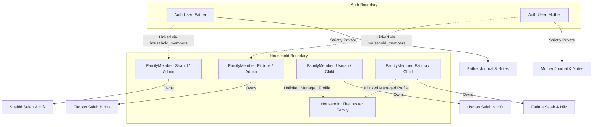

# CHILD / MEMBER DATA OWNERSHIP AUDIT

## 1. Current Leakage Path

### Problem Statement
When selecting a child `FamilyMember` (e.g., Usman) from the household/member selector (`MemberSelector`), the Daily Surface (`src/routes/index.tsx`) continues to display the authenticated parent's personal information, including prayer count, Salah logs, Hifz revision queues, personal habits, hydration, mood check-ins, and active reminders.

### Detailed Code Trace
1. **Selection Trigger**:
   - `MemberSelector` updates the active perspective via `setSelectedMemberId(m.id)` in `src/components/home/member-selector.tsx`.
   - `useSelectedMember()` in `src/lib/family-model.ts` saves this to localStorage key `veedu:selected_member_id` and returns `[selectedMemberId, setSelectedMemberId, activeMember]`.

2. **Daily Surface Data Assembly (`src/routes/index.tsx:Today()`)**:
   - `useSalah()` is invoked unconditionally: `const [salah] = useSalah();`. This reads directly from `veedu:salah`, which stores the authenticated parent's Salah log.
   - `salah[today]` is read into `loggedSalah`, and `prayed = Object.keys(loggedSalah).length;` is computed.
   - `useStore<HifzItem[]>("hifz", [])`, `useStore("habits", [])`, `useStore("health", [])`, `useStore("checkins", [])`, and `useReminderEngine()` are all read directly from un-scoped parent stores.

3. **Engine Thread Generation (`src/lib/daily-surface.ts:buildDailyThread()`)**:
   - `memberId: selectedMemberId` is passed into `buildDailyThread()`, but filtering is only implemented for:
     - **Tasks**: `filterTasksForMember(data.tasks, data.memberId)`
     - **Events**: `filterEventsForMember(data.events, data.memberId)`
     - **Routines**: `filterRoutinesForMember(data.routines, data.memberId)`
     - **Budget**: `isChildMember(data.memberId, data.familyMembers)` suppresses the budget card.
   - **All personal stores bypass filtering**:
     - *Prayer Countdown & Log*: Unconditionally emits item `prayer-countdown` using `data.salahLog` with text `${prayedCount}/5 logged` (Parent's prayers).
     - *Hifz Revision*: Unconditionally emits item `hifz-due` using `data.hifzItems` (Parent's Hifz items).
     - *Habits*: Unconditionally emits item `habits-summary` using `data.habits` (Parent's habits).
     - *Health*: Unconditionally emits item `health-water` using `data.health` (Parent's water intake).
     - *Mood/Check-in*: Unconditionally emits item `mood-checkin` using `data.checkins` (Parent's checkin).
     - *Reminders*: Emits item `reminder-*` from `data.activeReminders` (Parent's custom reminders).

4. **UI Presentation (`src/routes/index.tsx`)**:
   - `CalmToday` renders `<ProgressLine label="Salah" value={`${prayed}/5`} pct={(prayed / 5) * 100} />` showing parent's prayer count alongside greeting "Good afternoon, Usman."
   - `VibrantToday` renders `<PrayerRhythm prayers={prayers} logged={loggedSalah} prayed={prayed} />` with parent's completed prayer dots, plus thread cards for parent's Hifz, habits, and water intake.

### Leaked Domains Audit Table

| Source Key / Store | Current Owner | Filtering Function | UI Consumer | Reason for Leakage | Correct Future Owner |
|---|---|---|---|---|---|
| `veedu:salah` | Auth User | None | `Today()`, `CalmToday`, `VibrantToday`, `buildDailyThread` | Store is global/un-scoped; `Today()` reads parent log regardless of `selectedMemberId` | Member Profile (`FamilyMember`) |
| `veedu:hifz` | Auth User | None | `buildDailyThread` | `hifzItems` passed directly to `generateHifzRevisionQueue` without member scoping | Member Profile (`FamilyMember`) |
| `veedu:habits` | Auth User | None | `buildDailyThread` | Habits array evaluated without checking owner or member association | Member Profile (`FamilyMember`) |
| `veedu:health` | Auth User | None | `Today()`, `buildDailyThread` | Water metrics read from global `health` key | Member Profile (`FamilyMember`) |
| `veedu:checkins` | Auth User | None | `buildDailyThread` | Mood check-in evaluated from global `checkins` key | Member Profile (`FamilyMember`) |
| `veedu:reminders` | Auth User | None | `useReminderEngine`, `buildDailyThread` | Reminder engine evaluates all reminders in global store | Account User / Member Profile |
| `veedu:notesList` | Auth User | None | `Notes` tab | Global scratchpad rendered without author/privacy filter | Household (Shared) / Account User (Private) |

---

## 2. Domain Ownership Matrix

Every domain in the application is classified into its authoritative ownership model:

| Domain | Key(s) | Category | Rationale |
|---|---|---|---|
| **User Account Profile** | `profile` (auth user) | **ACCOUNT-PERSONAL** | Settings, geolocation, prayer calculation method, and account details of the authenticated user. |
| **Member Profile Record** | `family`, `kids` | **HOUSEHOLD** | Roster of family members with metadata (`name`, `role`, `age`, `color`, `avatar`). |
| **Salah Tracking** | `salah` | **FAMILY-MEMBER-PERSONAL** | Personal religious practice. Each individual (adult or child) logs their own 5 daily prayers. |
| **Fasting Records** | `fasting` | **FAMILY-MEMBER-PERSONAL** | Individual fasting tracking (voluntary, make-up, Ramadan). |
| **Quran Progress & Bookmarks** | `quran-*` | **FAMILY-MEMBER-PERSONAL** | Individual recitation state, bookmarks, and reading progress. |
| **Hifz Memorization** | `hifz` | **FAMILY-MEMBER-PERSONAL** | Individual retention scores, review intervals, and memorized surahs (vital for Madrasah/school children). |
| **Daily Habits** | `habits` | **FAMILY-MEMBER-PERSONAL** | Personal habits (e.g., "Read 10 mins", "No screen after Isha"). Children have distinct habits from adults. |
| **Health & Hydration** | `health`, `workouts`, `cycle` | **ACCOUNT-PERSONAL** / **MEMBER** | Health stats (weight, cycle, workouts) are Account-Personal. Water intake can be Member-Personal. |
| **Spiritual Deeds** | `deeds` | **HOUSEHOLD** | Family feed of good deeds noticed across all household members, with member attribution (`who`). |
| **Mood Check-ins** | `checkins` | **FAMILY-MEMBER-PERSONAL** | Subjective wellbeing reflection. |
| **Personal Journal** | `journal` | **ACCOUNT-PERSONAL** | Deeply private written thoughts. Strictly prohibited from being shared or exposed to other members. |
| **Scratchpad & Notes** | `notesList`, `notes` | **HOUSEHOLD** (Shared) / **ACCOUNT-PERSONAL** (Private) | Default notes are household-shared (Wifi codes, house instructions); private notes are account-only. |
| **Reminders & Nudges** | `reminders`, `notifPrefs` | **ACCOUNT-PERSONAL** / **MEMBER** | System notification permissions are device/account personal; scheduled reminders can be assigned. |
| **Tasks & Chores** | `tasks` | **HOUSEHOLD** | Household operational tasks, assigned to specific members (`assignedTo`) or unassigned. |
| **Family Routines** | `routines` | **HOUSEHOLD** | Structured household workflows, with routine-level owners and step-level assignees. |
| **Calendar Events** | `events` | **HOUSEHOLD** | Household schedule, with optional member assignments (`assignedTo`). |
| **Meal Planning** | `meals`, `recipes`, `mealHistory` | **HOUSEHOLD** | Shared household nutrition and dinner plans. |
| **Grocery Shopping** | `grocery` | **HOUSEHOLD** | Shared pantry and grocery list. |
| **Budget & Finances** | `expenses`, `limits`, `zakat` | **HOUSEHOLD** (Adults Only) | Household financial tracking. Suppressed from child perspectives. |
| **Weekly Plan Proposals** | `weeklyProposal` | **HOUSEHOLD** | Stage-and-commit weekly household coordination state. |
| **Analytics & Signals** | `insights`, derived metrics | **DERIVED** | Computed dynamically from tasks, routines, and prayer compliance for the active perspective. |

---

## 3. Child Data Ownership Recommendation

Children in Firdaus require first-class personal/member data partitions without requiring an authentication account:

| Life Domain | First-Class Child Data? | Justification | Current Gap | Suggested Scope |
|---|---|---|---|---|
| **Salah** | **YES** | Children learning prayer need their own distinct daily progress without seeing or overwriting parents' logs. | `useSalah` is single-tenant global `veedu:salah`. | `member:<childId>:salah` |
| **Fasting** | **YES** | Children tracking their practice fasts during Ramadan or voluntary fasts. | `fasting` is single-tenant global. | `member:<childId>:fasting` |
| **Quran Progress** | **YES** | Children read different surahs/juz than parents; bookmarks must be isolated. | Single global bookmarks store. | `member:<childId>:quran` |
| **Hifz Memorization** | **YES** | Critical feature: children memorizing Quran in Madrasah need individual revision queues and spaced repetition. | `hifz` store is global; child queue mixes with parent queue. | `member:<childId>:hifz` |
| **Good Deeds** | **YES (Household Feed)** | Deeds celebrate acts of kindness by children; attributed to child in the shared family stream. | Attributed via string `who` instead of member ID. | `household:deeds` (`memberId` linked) |
| **Habits** | **YES** | Children have child-appropriate habits ("Pack school bag", "Brush teeth", "Dua before sleep"). | `habits` is global; parent habits displayed to child. | `member:<childId>:habits` |
| **Reflections / Journal** | **NO** | Young children do not use private text journals. Adult journals must remain strictly Account-Personal. | N/A — keep disabled for children. | `account:journal` (Hidden from Child) |
| **Notes** | **NO** | Children view shared household scratchpad notes (e.g. Wifi, house rules). | `notesList` is un-scoped. | `household:notes` |
| **Health / Water** | **OPTIONAL / YES** | Simple hydration tracking can be enabled for kids; sensitive health (weight/cycle) is strictly adult personal. | `health` is global; adult health mixes with child water. | `member:<childId>:health:water` |
| **Reminders / Push** | **MANAGED ONLY** | Children do not manage device notification settings; parent devices handle notifications. | `notifPrefs` is global. | `account:notifPrefs` |

---

## 4. Adult Member Ownership Recommendation

For authenticated adult members (e.g., Father and Mother having separate logins):
1. **Strictly Private Account Data**:
   - Journal, reflections, personal notes, cycle/intimate health, account preferences.
   - Accessible **ONLY** when authenticated as that user (`user_id === auth.uid()`).
   - Invisible to spouse even within the same household.
2. **Member-Personal Ibadah & Growth Data**:
   - Salah log, Hifz revision schedule, personal Quran bookmarks, personal habits.
   - Owned by the adult's linked `FamilyMember.id`.
   - Accessible by that adult on their own device.
3. **Household Operational Data**:
   - Tasks assigned to them, routines owned by them, calendar events, shared meals, groceries, and shared household budget.

---

## 5. Household Data Ownership

Household data belongs to the collective household unit (`household_id`):
- **Shared Pool**: Any active member of the household can view meals, grocery lists, calendar events, household routines, and the family members roster.
- **Role-Based Restrictions**:
  - *Children*: Budget, financial limits, fairness metrics, and adult overdue workload diagnostics are automatically suppressed from the UI.
  - *Adults/Admins*: Full visibility into household finances, assignments, and child member profiles.

---

## 6. Daily Surface Ownership Matrix

The table below defines how each input to `buildDailyThread` and the Home Surface must resolve under each perspective:

| Daily Surface Input | Household Perspective (`selectedMemberId === undefined`) | Adult Member Perspective (Self / Spouse) | Child Member Perspective (e.g., Usman) | Authority Owner |
|---|---|---|---|---|
| **Ramadan Suhur/Iftar** | Active (Household countdown) | Active (Household countdown) | Active (Household countdown) | Household / Calculation |
| **Next Prayer Timing** | Active (Astronomical time only) | Active (Astronomical time + "X/5 logged") | Active (Astronomical time + "Usman: X/5 logged") | Calculation (Times) + Member (Log) |
| **Salah Progress Bar** | Aggregated Household completion (or hidden) | Personal Salah count (`user.salah`) | Child Salah count (`child.salah`, default 0/5) | Member Profile |
| **Prayer Rhythm Dots** | Suppressed or Household Overview | Personal 5-prayer rhythm dots | Child 5-prayer rhythm dots | Member Profile |
| **Active Reminders** | Household-wide alarms only | Personal active reminders | Child-assigned reminders or Suppressed | Account / Member |
| **Hifz Revision Queue** | Household Hifz Overview (or hidden) | Active User Hifz queue | Child's Hifz queue (`child.hifz`) | Member Profile |
| **Calendar Events** | All Household events | Member-assigned + Unassigned events | Child-assigned + Unassigned events | Household (`assignedTo`) |
| **Actionable Tasks** | All open Household tasks | Tasks assigned to Adult + Unassigned | Tasks assigned to Child + Unassigned | Household (`assignedTo`) |
| **Family Routines** | All Household routines | Routines owned / steps for Adult | Routines owned / steps for Child | Household (`assignedTo`) |
| **Planned Dinner** | Active (Tonight's household dinner) | Active (Tonight's household dinner) | Active (Tonight's household dinner) | Household |
| **Grocery Remaining** | Active (Items left to buy) | Active (Items left to buy) | Active (Items left to buy) | Household |
| **Habits Summary** | Suppressed | Personal habits summary | Child habits summary (`child.habits`) | Member Profile |
| **Water / Hydration** | Suppressed | Personal water intake | Child water intake (if tracked) | Member Profile |
| **Wellbeing Check-in** | Suppressed | Personal mood prompt | Child mood check-in (or suppressed) | Member Profile |
| **Budget Alert** | Active (Household limit warning) | Active (Household limit warning) | **SUPPRESSED** (Always hidden) | Household (Adults only) |
| **Completed Count** | Total household items completed today | Items completed by Adult | Items completed by Child | Derived from filtered tasks |

---

## 7. FamilyMember vs Auth User Boundary

### Conceptual Distinction
- **`Auth User` (`auth.users.id`)**:
  - The security boundary.
  - Represents a physical adult with login credentials (email/password/OTP), a Supabase session, and RLS authentication tokens.
  - Controls billing, household creation, device synchronization, and private journals.
- **`FamilyMember` (`FamilyMember.id`)**:
  - The household domain identity.
  - Represents a person within the home (Father, Mother, Child 1, Child 2, Grandmother).
  - Holds assignments for tasks, routine ownership, chore completion history, prayer tracking, and Hifz revision.

### The Architectural Mapping


---

## 8. Shared Device Model (Managed Child Profile)

In typical family life, children (e.g., Usman, age 7) do not carry smartphones or have email addresses. They interact with Firdaus through a shared iPad, kitchen tablet, or parent's phone.

### Operating Principles
1. **Parent-Authenticated Context**: The parent is logged into their Supabase account. The session token belongs to the parent.
2. **Perspective Switching (No Impersonation)**:
   - When Dad taps "Usman" in the `MemberSelector`, the UI switches perspective to Usman's managed child profile.
   - The application does not alter the Supabase auth token.
   - The application directs reads and writes to Usman's member partition (`veedu:mem_usman:...`).
3. **Guardian Authorization**:
   - Because the parent is an authenticated `admin` of the household, they have explicit guardian rights to record Usman's Salah, log his Hifz recitation, and mark his daily habits.
4. **Leakage Prevention**:
   - When perspective === "Usman", the parent's private stores (`account:*`) are completely detached from the render tree.

---

## 9. Proposed Ownership Architecture

### 3-Tier Scoping Model

1. **`ACCOUNT` Scope (`scope = 'account'`)**:
   - **Key Format**: `veedu:acc_<userId>:<domain>`
   - **DB Table**: `user_data` (where `user_id = auth.uid()` and `scope = 'account'`)
   - **Domains**: `profile`, `journal`, `cycle`, `private_notes`, `notifPrefs`.
   - **Visibility**: Exclusively the authenticated user.

2. **`MEMBER` Scope (`scope = 'member'`)**:
   - **Key Format**: `veedu:mem_<memberId>:<domain>`
   - **DB Table**: `member_data` (where `household_id = <hhId>`, `member_id = <memId>`)
   - **Domains**: `salah`, `hifz`, `habits`, `fasting`, `quran`, `water`.
   - **Visibility**: The member themselves (if linked to auth account) + Household Admins (for managed child profiles).

3. **`HOUSEHOLD` Scope (`scope = 'household'`)**:
   - **Key Format**: `veedu:hh_<householdId>:<domain>`
   - **DB Table**: `household_data` (where `household_id = <hhId>`)
   - **Domains**: `family`, `tasks`, `routines`, `events`, `meals`, `recipes`, `grocery`, `expenses`, `limits`, `deeds`, `weeklyProposal`.
   - **Visibility**: All active members of the household (with child role suppressing budget).

---

## 10. LocalStorage Strategy

### Namespace Partitioning
To maintain offline-first capability and prevent cross-perspective data leakage, the storage layer in `src/lib/store.ts` must evolve from flat `veedu:<domain>` keys to scoped keys:

```typescript
// Proposed Storage Key Schema
const formatAccountKey = (userId: string, key: string) => `veedu:acc_${userId}:${key}`;
const formatMemberKey = (memberId: string, key: string) => `veedu:mem_${memberId}:${key}`;
const formatHouseholdKey = (householdId: string, key: string) => `veedu:hh_${householdId}:${key}`;
```

### Perspective Resolution in Hooks
```typescript
// Example: Scoped Salah Hook
export function useMemberSalah(memberId?: string) {
  // If memberId is specified, read that member's partition.
  // If undefined (Household), return empty or aggregated summary.
  const key = memberId ? `mem_${memberId}:salah` : `salah_overview`;
  return useStore<SalahLog>(key, {});
}
```

### Cache Invalidation & Logout
- **Perspective Switch**: Simply changes the active React state subscription to point to `mem_<newMemberId>:*`.
- **Logout Event**: All `acc_*` and cached `mem_*` data for that device must be purged from localStorage if on a non-trusted device, or unmounted cleanly.

---

## 11. Supabase / RLS Strategy

### Database Schema Structure
```sql
-- 1. Account Private Data
CREATE TABLE account_data (
  id uuid PRIMARY KEY DEFAULT gen_random_uuid(),
  user_id uuid NOT NULL REFERENCES auth.users(id) ON DELETE CASCADE,
  key text NOT NULL,
  value jsonb NOT NULL,
  updated_at timestamptz DEFAULT now(),
  UNIQUE (user_id, key)
);

-- 2. Household Shared Data
CREATE TABLE household_data (
  id uuid PRIMARY KEY DEFAULT gen_random_uuid(),
  household_id uuid NOT NULL REFERENCES households(id) ON DELETE CASCADE,
  key text NOT NULL,
  value jsonb NOT NULL,
  updated_at timestamptz DEFAULT now(),
  UNIQUE (household_id, key)
);

-- 3. Member Profile Data (Salah, Hifz, Habits)
CREATE TABLE member_data (
  id uuid PRIMARY KEY DEFAULT gen_random_uuid(),
  household_id uuid NOT NULL REFERENCES households(id) ON DELETE CASCADE,
  family_member_id text NOT NULL,
  key text NOT NULL,
  value jsonb NOT NULL,
  updated_at timestamptz DEFAULT now(),
  UNIQUE (household_id, family_member_id, key)
);
```

### Row Level Security (RLS) Policies

1. **`account_data`**:
   ```sql
   ALTER TABLE account_data ENABLE ROW LEVEL SECURITY;
   CREATE POLICY "Users own their account data" ON account_data
   FOR ALL USING (user_id = auth.uid());
   ```

2. **`household_data`**:
   ```sql
   ALTER TABLE household_data ENABLE ROW LEVEL SECURITY;
   CREATE POLICY "Members access household data" ON household_data
   FOR ALL USING (
     household_id IN (
       SELECT household_id FROM household_members 
       WHERE user_id = auth.uid() AND status = 'active'
     )
   );
   ```

3. **`member_data`**:
   ```sql
   ALTER TABLE member_data ENABLE ROW LEVEL SECURITY;
   CREATE POLICY "Admins manage child data and adults read own data" ON member_data
   FOR ALL USING (
     household_id IN (
       SELECT household_id FROM household_members 
       WHERE user_id = auth.uid() AND status = 'active'
     )
   );
   ```

---

## 12. Backup / Export Strategy

When exporting Sunnah Home data (`src/lib/backup.ts` / `exportAllData`), the payload must be cleanly structured so child data is never restored into a parent profile.

### Structured Export Format (Version 2.5)
```json
{
  "app": "Sunnah Home",
  "version": "2.5",
  "exportedAt": "2026-08-18T14:30:00Z",
  "account": {
    "profile": { "name": "Shahid", "city": "Kozhikode" },
    "journal": { "...": "..." },
    "cycle": {}
  },
  "household": {
    "id": "hh_99812",
    "name": "Laskar Family",
    "data": {
      "tasks": [ "... tasks ..." ],
      "routines": [ "... routines ..." ],
      "events": [ "... events ..." ],
      "meals": { "... meals ..." },
      "grocery": [ "... grocery ..." ],
      "expenses": [ "... expenses ..." ],
      "limits": { "... limits ..." },
      "deeds": [ "... deeds ..." ]
    }
  },
  "members": [
    {
      "id": "mem_shahid",
      "name": "Shahid",
      "role": "admin",
      "data": {
        "salah": { "... Shahid's 5 prayers ..." },
        "hifz": [ "... Shahid's Hifz ..." ],
        "habits": [ "... Shahid's habits ..." ]
      }
    },
    {
      "id": "mem_usman",
      "name": "Usman",
      "role": "child",
      "data": {
        "salah": { "... Usman's 3 prayers ..." },
        "hifz": [ "... Usman's Juz Amma Hifz ..." ],
        "habits": [ "... Usman's habits ..." ]
      }
    }
  ]
}
```

---

## 13. Migration Strategy for Existing Users

### Zero Data Loss & Clean Partitioning
1. **Identify Primary Member**:
   - For an existing user with legacy unpartitioned keys (`veedu:salah`, `veedu:hifz`, `veedu:habits`), identify their own `FamilyMember` profile (e.g. role: `admin`, name matching profile).
2. **Assign Existing Ibadah to Primary Member**:
   - Migrate `veedu:salah` → `veedu:mem_<ownerMemberId>:salah`.
   - Migrate `veedu:hifz` → `veedu:mem_<ownerMemberId>:hifz`.
   - Migrate `veedu:habits` → `veedu:mem_<ownerMemberId>:habits`.
3. **Initialize Clean Stores for Children**:
   - Ensure child members (`mem_usman`, `mem_fatima`) start with empty, independent member stores `{}`.
4. **Preserve Legacy Key as Backup**:
   - Do not delete `veedu:salah` immediately; keep it until confirmed by migration verification tests.

---

## 14. UX Semantics

### Perspective Expectations

#### 1. Household View (`selectedMemberId === undefined`)
- **Tone**: Collective, calm, ambient home overview.
- **Greeting**: *"Good afternoon, Shahid."* (or *"Good afternoon, Family."*)
- **Content**: Shared dinner, groceries left to buy, all household tasks, family calendar, total family routine progress.
- **Worship**: Universal prayer times countdown (e.g. *"Asr in 42m"*), but **no personal prayer count** (`prayed/5` is suppressed).

#### 2. Father View (`selectedMemberId === fatherMemberId`)
- **Tone**: Personal focus + father's responsibilities.
- **Greeting**: *"Good afternoon, Shahid."*
- **Content**: Tasks assigned to Shahid + unassigned tasks, routines Shahid owns, Shahid's prayer countdown with `${shahidPrayed}/5 logged`, Shahid's Hifz revision alert, Shahid's habit progress, Shahid's water tracking.

#### 3. Wife View (`selectedMemberId === wifeMemberId` on Father's device)
- **Tone**: Family coordination perspective.
- **Content**: Tasks assigned to Wife, routines owned by Wife.
- **Privacy Rule**: Private journal/notes are **hidden**. If Wife has linked her own auth account, her personal worship is private to her unless explicitly shared.

#### 4. Child View (`selectedMemberId === usmanMemberId`)
- **Tone**: Encouraging, child-friendly, focused.
- **Greeting**: *"Good afternoon, Usman."*
- **Content**: Tasks assigned to Usman, routines with steps for Usman, Usman's Salah check-in, Usman's Surah revision for Madrasah, Usman's daily habits ("Brush teeth").
- **Privacy Rule**: **Zero exposure** of Father's Salah count, Father's Hifz, Father's budget warnings, or adult workload stress.

---

## 15. Required Domain Changes

1. **`src/lib/family-model.ts`**:
   - Extend `FamilyMember` type to define `linkedUserId?: string`.
   - Provide helper `getEffectiveMemberStoreKey(domain: string, memberId?: string)`.
2. **`src/lib/daily-surface.ts`**:
   - Refactor `DailySurfaceData` to accept member-scoped `salahLog`, `hifzItems`, `habits`, and `health`.
   - Suppress prayer counts and habits when in `Household` perspective unless aggregated.
3. **`src/routes/index.tsx`**:
   - Update `Today()` component to pass member-scoped datasets into `buildDailyThread` based on `selectedMemberId`.
   - Update `CalmToday` and `VibrantToday` to render prayer rhythm and progress lines corresponding strictly to `selectedMemberId`.
4. **`src/components/deen/modules.tsx`**:
   - Refactor `useSalah()` and `useHifz()` to support optional `memberId` parameter.

---

## 16. Required Database Changes

1. Create `households` tenant table.
2. Create `household_members` junction table linking `user_id` and `family_member_id`.
3. Separate single-table `user_data` into:
   - `account_data` (personal user records)
   - `household_data` (shared household records)
   - `member_data` (member-scoped ibadah & growth records)
4. Enable RLS on all 3 tables with the policies outlined in Section 11.

---

## 17. Required Tests

1. **Child Perspective Personal Isolation**:
   - When `selectedMemberId = child.id` and Father has 4/5 prayers logged, assert Child Daily Surface displays 0/5 prayers.
2. **Child Perspective Hifz Isolation**:
   - When Father has Surah Al-Baqarah in Hifz queue and Child has Surah An-Naba, assert Child view displays only Surah An-Naba revision.
3. **Child Perspective Budget Suppression**:
   - Assert `budget-alert` thread item is never generated when `isChildMember === true`.
4. **Household View Privacy**:
   - Assert Household view (`selectedMemberId === undefined`) does not show any individual's personal journal, health, or private prayer counts.
5. **Perspective Switching State Preservation**:
   - Assert checking off a task for Usman does not mutate tasks assigned to Father.
   - Assert logging a prayer for Usman writes to Usman's member store and leaves Father's prayer log unchanged.
6. **Zero Leaks on Unassigned Switch**:
   - Assert switching from Child to Household to Adult cleanly updates all reactive stores without stale memory leaks.

---

## 18. What MUST NOT Be Done

1. **DO NOT** create full Supabase Auth accounts (emails/passwords) for young children. Children must remain lightweight `FamilyMember` records.
2. **DO NOT** store child personal data inside the parent's un-scoped `veedu:salah` or `veedu:hifz` keys.
3. **DO NOT** treat `selectedMemberId` as a cosmetic UI filter over parent data. It must resolve to an authentic member-scoped data partition.
4. **DO NOT** allow Adult A to read Adult B's private journal or reflections under any perspective.
5. **DO NOT** execute destructive database migrations that wipe existing single-user local storage.

---

## 19. Risks

1. **Stale Cache / Context Confusion**: If React hooks do not re-subscribe when `selectedMemberId` changes, UI components may render stale prayer counts from the previous member.
2. **Offline Data Desynchronization**: If two parents update a child's Hifz progress on different devices while offline, last-write-wins at the monolithic key level could overwrite reviews.
3. **Migration Misattribution**: If an automated migration script assigns existing prayer history to a child instead of the parent account owner, historical analytics will be corrupted.

---

## 20. Final Recommendation

### **READY FOR HOUSEHOLD ARCHITECTURE DESIGN**

The root cause of personal data leakage has been thoroughly traced to unpartitioned global local storage keys and missing member-scoping in `Today()` and `buildDailyThread()`. The 3-tier ownership model (`ACCOUNT`, `MEMBER`, `HOUSEHOLD`) cleanly resolves the bug, supports managed child profiles on shared family devices, protects adult privacy, and establishes a secure foundation for Wave 2.5 Household Identity & Sharing.
